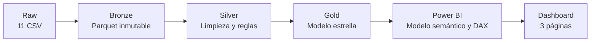
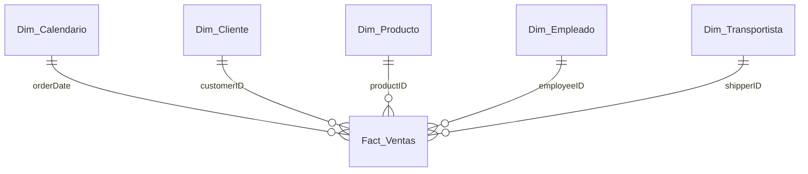
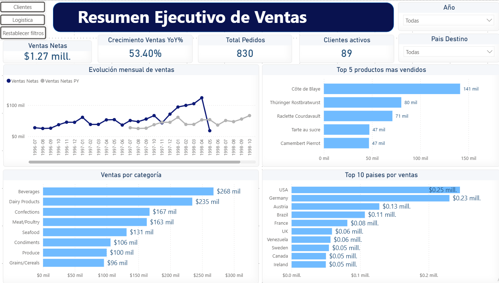
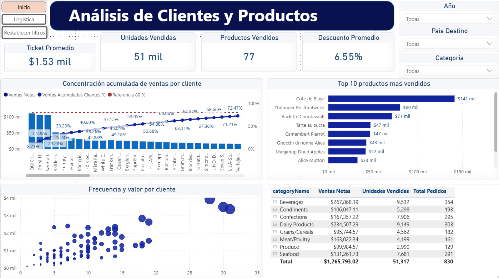
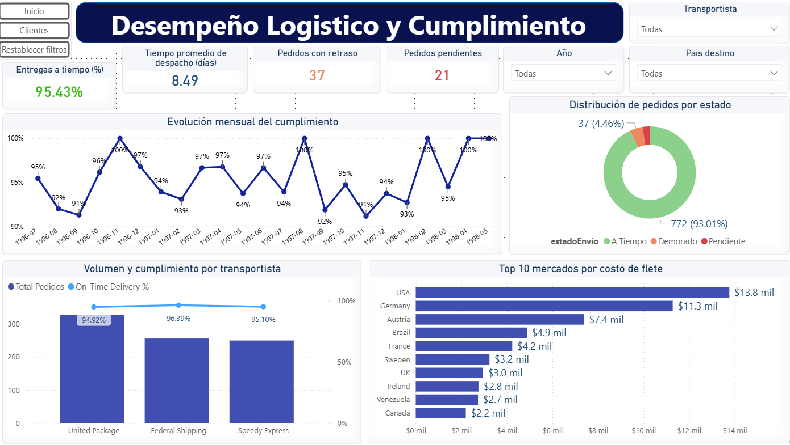

# Northwind BI Analytics

Proyecto integral de Business Intelligence que transforma las fuentes operativas
de Northwind en un modelo analítico reproducible y un dashboard interactivo en
Power BI. La solución implementa una arquitectura Medallón local con Python,
Parquet, modelado dimensional y medidas DAX.

## Objetivo

Construir una fuente analítica confiable para responder preguntas sobre ventas,
clientes, productos y desempeño logístico, manteniendo trazabilidad desde los CSV
originales hasta los indicadores presentados en Power BI.

## Resultados principales

| Indicador | Resultado |
| :--- | ---: |
| Ventas brutas | $1,354,458.59 |
| Descuentos otorgados | $88,665.57 |
| Ventas netas | $1,265,793.02 |
| Pedidos | 830 |
| Líneas de pedido | 2,155 |
| Unidades vendidas | 51,317 |
| Clientes con compras | 89 |
| Productos vendidos | 77 |
| On-Time Delivery | 95.43% |
| Flete total | $64,942.69 |

La conciliación entre Raw, Bronze, Silver, Gold y Power BI presenta una diferencia
financiera de **$0.00**.

## Arquitectura



| Capa | Propósito | Formato |
| :--- | :--- | :--- |
| Raw | Preservar las 11 fuentes originales | CSV |
| Bronze | Replicar las fuentes con paridad de registros | Parquet/Snappy |
| Silver | Estandarizar tipos, textos, nulos y reglas de negocio | Parquet/Snappy |
| Gold | Publicar el modelo estrella para consumo analítico | Parquet/Snappy |
| Power BI | Modelar métricas DAX y visualizaciones interactivas | PBIP/TMDL |

## Modelo dimensional

El modelo Gold contiene una tabla de hechos y cinco dimensiones conformadas.
El grano de `Fact_Ventas` es una línea de producto dentro de un pedido.



Las relaciones son 1:N y utilizan dirección de filtro simple desde las dimensiones
hacia la tabla de hechos. La inteligencia temporal automática está deshabilitada y
`Dim_Calendario` funciona como tabla oficial de fechas.

## Dashboard

El informe se distribuye en tres páginas de 1280 × 720:

1. **Visión Ejecutiva:** KPIs, evolución mensual, productos, categorías y mercados.
2. **Clientes y Productos:** Pareto de clientes, Top productos, relación entre
   volumen y ventas y detalle comercial.
3. **Logística:** puntualidad, estado de pedidos, transportistas, tiempos de
   despacho y costo de flete.

Incluye segmentadores sincronizados por año y país, navegación entre páginas,
marcadores para restablecer filtros e interacciones configuradas según el objetivo
de cada gráfico.

### Capturas del dashboard

#### 1. Visión Ejecutiva



#### 2. Clientes y Productos



#### 3. Logística



## Tecnologías

- Python
- pandas
- PyArrow y Parquet con compresión Snappy
- Jupyter Notebook
- Power BI Desktop
- Power Query / M
- DAX
- PBIP y TMDL

## Estructura del repositorio

```text
Proyecto_Northwind_BI/
├── data/
│   ├── raw/northwind/       # CSV originales
│   ├── bronze/              # Réplica Parquet
│   ├── silver/              # Datos depurados
│   └── gold/                # Modelo dimensional
├── docs/
│   ├── acta_validacion_pipeline.md
│   ├── auditoria_final.md
│   ├── diccionario_datos.md
│   ├── modelo_datos.md
│   └── reglas_calidad.md
├── notebooks/
│   ├── 01_eda_fuentes.ipynb
│   ├── 02_calidad_datos.ipynb
│   ├── 03_transformacion_silver.ipynb
│   ├── 04_modelado_gold.ipynb
│   └── 05_validacion_final.ipynb
├── powerbi/
│   ├── Northwind_Analytics.pbip
│   ├── Northwind_Analytics.Report/
│   ├── Northwind_Analytics.SemanticModel/
│   └── validacion_*.dax
├── src/
│   ├── bronze/ingesta_bronze.py
│   ├── silver/transformacion_silver.py
│   └── gold/modelado_gold.py
├── README.md
└── requirements.txt
```

## Ejecución local

### 1. Preparar el entorno

```powershell
python -m venv .venv
.\.venv\Scripts\Activate.ps1
python -m pip install -r requirements.txt
```

### 2. Ejecutar el pipeline

Desde la raíz del proyecto:

```powershell
python src/bronze/ingesta_bronze.py
python src/silver/transformacion_silver.py
python src/gold/modelado_gold.py
```

Los scripts utilizan rutas relativas a la raíz del proyecto. Los CSV de
`data/raw/northwind/` se consideran fuentes de solo lectura.

### 3. Ejecutar la validación

Abrir y ejecutar:

```text
notebooks/05_validacion_final.ipynb
```

El resultado esperado es una conciliación exacta entre las cuatro capas, sin
claves huérfanas, duplicados dimensionales ni diferencias financieras.

### 4. Abrir Power BI

Abrir `powerbi/Northwind_Analytics.pbip` con Power BI Desktop. Las seis consultas
Parquet utilizan el parámetro centralizado `RutaGold`, cuyo valor versionado es una
ruta de ejemplo. Después de clonar el proyecto, abrir **Transformar datos >
Administrar parámetros**, cambiar `RutaGold` para que apunte a la carpeta local
`data/gold/` y ejecutar
**Actualizar**. No es necesario editar cada consulta por separado.

Las consultas DAX incluidas en `powerbi/validacion_*.dax` permiten volver a
comprobar las medidas base, temporales, Pareto y logísticas.

## Controles de calidad

- Paridad completa de filas y columnas entre Raw y Bronze.
- Reglas de limpieza y tratamiento de nulos documentadas.
- 2,155 líneas y 830 pedidos conservados en todas las capas.
- Claves primarias dimensionales únicas y no nulas.
- Cero claves foráneas huérfanas.
- Calendario diario continuo con 1,096 fechas.
- Diferencia financiera Raw–Gold de $0.00.
- Medidas DAX comprobadas contra Python.

La evidencia se encuentra en
[`docs/acta_validacion_pipeline.md`](docs/acta_validacion_pipeline.md) y
[`docs/auditoria_final.md`](docs/auditoria_final.md).

## Hallazgos de negocio

- Las ventas netas históricas ascienden a **$1.27 millones** sobre 830 pedidos.
- Los descuentos representan aproximadamente **6.55%** de las ventas brutas.
- Los 20 clientes principales concentran **63.11%** de las ventas netas; se
  requieren 34 clientes para alcanzar el umbral acumulado del 80%.
- `QUICK-Stop` es el cliente con mayor facturación, con **$110,277.32** y una
  participación aproximada de **8.71%**.
- El cumplimiento de despacho alcanza **95.43%** entre los pedidos enviados:
  772 a tiempo y 37 demorados.
- Existen 21 pedidos pendientes, equivalentes al **2.53%** del total.
- El tiempo medio entre pedido y despacho es de **8.49 días**.
- Federal Shipping registra la mayor tasa histórica de puntualidad entre los tres
  transportistas, con aproximadamente **96.39%**.

Los datos de 1998 llegan únicamente hasta el 6 de mayo; por ello, sus ventas no
deben compararse como un año completo contra 1997.

## Documentación

- [Modelo dimensional](docs/modelo_datos.md)
- [Diccionario de datos](docs/diccionario_datos.md)
- [Reglas de calidad](docs/reglas_calidad.md)
- [Acta de validación del pipeline](docs/acta_validacion_pipeline.md)

