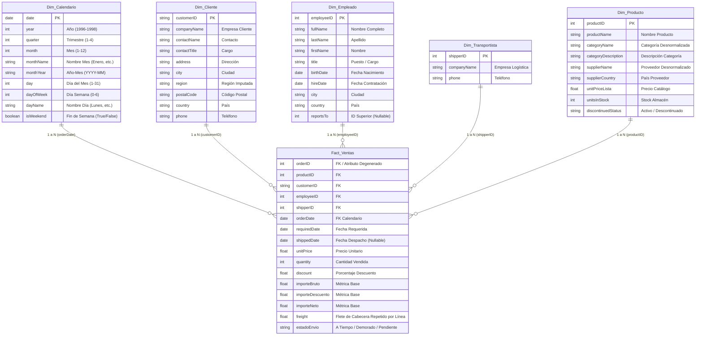

# Especificación del Modelo Dimensional (Esquema Estrella) — Northwind BI

> **Documento:** Diseño de Arquitectura Dimensional y Modelo Analítico (Capa Gold)  
> **Metodología:** Ralph Kimball (Dimensional Data Warehousing)  
> **Alcance:** Capa Gold (Parquet) ➔ Power BI Desktop  
> **Estado:** Aprobado para implementación en `src/gold/`

---

## 1. Visión General de la Arquitectura

Para transformar los datos limpios de la **Capa Silver** en una solución analítica de alto rendimiento para **Power BI**, se adopta un **Modelo Dimensional Tipo Estrella (Star Schema)**.

### Del Esquema Relacional Normalizado (OLTP) al Esquema Estrella (OLAP)

En el sistema original, las tablas estaban fragmentadas para optimizar transacciones (normalización). En Business Intelligence, mantener ese esquema "Copo de Nieve" fragmenta las consultas y degrada la velocidad de las medidas DAX.

* **Decisión de Ingeniería:** Desnormalizamos las entidades relacionadas de segundo nivel:
  * `categories` y `suppliers` se integran directamente dentro de **`Dim_Producto`**.
  * `orders` y `order-details` se fusionan para dar vida a la tabla de hechos central **`Fact_Ventas`**.
* **Resultado:** Reducción de 11 tablas dispersas a **1 Tabla de Hechos central rodeada por 5 Dimensiones conformadas**.

---

## 2. Declaración del Grano (Granularity)

> **"Un registro en la tabla de hechos representa exactamente un producto vendido dentro de una orden de compra específica."**

* **Clave Técnica Compuesta:** `(orderID, productID)`.
* **Volumen Fijo de Registros:** Exactamente **2,155 filas**.
* **Garantía:** No se agrupan órdenes a nivel de cabecera en el Data Lakehouse; cada línea de detalle conserva su precio, descuento y cantidad original para permitir análisis a cualquier nivel de jerarquía.

---

## 3. Diagrama del Modelo Estrella (Star Schema)

---

## 4. Especificación Detallada de Entidades (Capa Gold)

### 4.1. Tabla de Hechos: `Fact_Ventas` (data/gold/Fact_Ventas.parquet)
* **Origen Silver:** `orders.parquet` cruzado con `order-details.parquet`.
* **Granularidad:** Línea de venta (2,155 filas).
* **Columnas y Tipos:**
  * `orderID` (`int64`): Identificador del pedido.
  * `productID` (`int64`): Clave foránea hacia `Dim_Producto`.
  * `customerID` (`string`): Clave foránea hacia `Dim_Cliente`.
  * `employeeID` (`int64`): Clave foránea hacia `Dim_Empleado`.
  * `shipperID` (`int64`): Clave foránea hacia `Dim_Transportista` (mapeado desde `shipVia`).
  * `orderDate` (`datetime64[ns]`): Clave foránea hacia `Dim_Calendario`.
  * `requiredDate` (`datetime64[ns]`): Fecha límite pactada.
  * `shippedDate` (`datetime64[ns]`): Fecha real de despacho (permite nulos para pedidos en tránsito).
  * `unitPrice` (`float64`): Precio de venta pactado en la transacción.
  * `quantity` (`int64`): Unidades vendidas.
  * `discount` (`float64`): Descuento aplicado (0.00 a 0.25).
  * `importeBruto` (`float64`): Subtotal antes de descuento ($unitPrice \times quantity$).
  * `importeDescuento` (`float64`): Monto monetario descontado.
  * `importeNeto` (`float64`): Venta real devengada ($importeBruto - importeDescuento$).
  * `freight` (`float64`): Costo de envío de la orden, repetido en sus líneas y agregado una sola vez por pedido mediante DAX.
  * `estadoEnvio` (`string`): Segmento logístico (`A Tiempo`, `Demorado`, `Pendiente`).

---

### 4.2. Dimensión: `Dim_Producto` (data/gold/Dim_Producto.parquet)
* **Origen Silver:** `products.parquet` enriquecido con `categories.parquet` y `suppliers.parquet`.
* **Granularidad:** 1 fila por producto (77 filas).
* **Desnormalización:**
  * De `categories`: se absorbe `categoryName` y `description` (como `categoryDescription`).
  * De `suppliers`: se absorbe `companyName` (como `supplierName`) y `country` (como `supplierCountry`).
* **Columnas:** `productID`, `productName`, `categoryName`, `categoryDescription`, `supplierName`, `supplierCountry`, `unitPrice` (como `unitPriceLista`), `unitsInStock`, `unitsOnOrder`, `reorderLevel`, `discontinuedStatus`.

---

### 4.3. Dimensión: `Dim_Cliente` (data/gold/Dim_Cliente.parquet)
* **Origen Silver:** `customers.parquet`.
* **Granularidad:** 1 fila por cliente (91 filas).
* **Exclusiones:** Se descarta la columna `fax` por ser un atributo obsoleto que no aporta valor analítico.
* **Columnas:** `customerID`, `companyName`, `contactName`, `contactTitle`, `address`, `city`, `region`, `postalCode`, `country`, `phone`.

---

### 4.4. Dimensión: `Dim_Empleado` (data/gold/Dim_Empleado.parquet)
* **Origen Silver:** `employees.parquet`.
* **Granularidad:** 1 fila por empleado (9 filas).
* **Columnas:** `employeeID`, `fullName`, `lastName`, `firstName`, `title`, `titleOfCourtesy`, `birthDate`, `hireDate`, `city`, `region`, `country`, `reportsTo`.

---

### 4.5. Dimensión: `Dim_Transportista` (data/gold/Dim_Transportista.parquet)
* **Origen Silver:** `shippers.parquet`.
* **Granularidad:** 1 fila por transportista (3 filas).
* **Columnas:** `shipperID`, `companyName`, `phone`.

---

### 4.6. Dimensión: `Dim_Calendario` (data/gold/Dim_Calendario.parquet)
* **Generación:** Programática en Python a partir de una secuencia diaria ininterrumpida.
* **Rango:** `1996-01-01` al `1998-12-31` (**1,096 días continuos**).
* **Columnas:**
  * `date` (`datetime64[ns]`): Fecha única clave.
  * `year` (`int64`): Año calendario (1996, 1997, 1998).
  * `quarter` (`int64`): Trimestre (1, 2, 3, 4).
  * `quarterName` (`string`): Formato `T1`, `T2`, `T3`, `T4`.
  * `month` (`int64`): Número de mes (1 al 12).
  * `monthName` (`string`): Nombre completo del mes.
  * `monthYear` (`string`): Formato `YYYY-MM`.
  * `day` (`int64`): Día del mes (1 al 31).
  * `dayOfWeek` (`int64`): Día de la semana (0 a 6).
  * `dayName` (`string`): Nombre del día (Lunes, Martes, etc.).
  * `isWeekend` (`boolean`): Bandera de fin de semana.

---

## 5. Matriz de Relaciones Dimensionales (Power BI)

Todas las relaciones del modelo analítico cumplen con las mejores prácticas de Power BI:

| Tabla Dimensión (Lado 1) | Clave PK | Tabla de Hechos (Lado N) | Clave FK | Cardinalidad | Dirección Filtro |
| :--- | :--- | :--- | :--- | :--- | :--- |
| `Dim_Cliente` | `customerID` | `Fact_Ventas` | `customerID` | 1 a Varios (1:N) | Unidireccional (Single) |
| `Dim_Producto` | `productID` | `Fact_Ventas` | `productID` | 1 a Varios (1:N) | Unidireccional (Single) |
| `Dim_Empleado` | `employeeID` | `Fact_Ventas` | `employeeID` | 1 a Varios (1:N) | Unidireccional (Single) |
| `Dim_Transportista` | `shipperID` | `Fact_Ventas` | `shipperID` | 1 a Varios (1:N) | Unidireccional (Single) |
| `Dim_Calendario` | `date` | `Fact_Ventas` | `orderDate` | 1 a Varios (1:N) | Unidireccional (Single) |

---

## 6. Diccionario de Métricas y Cálculos DAX Previstos

| Métrica | Tipo | Definición Técnica | Objetivo de Negocio |
| :--- | :--- | :--- | :--- |
| **Venta Bruta** | Base | `SUM(Fact_Ventas[importeBruto])` | Facturación total teórica antes de descuentos. |
| **Descuentos** | Base | `SUM(Fact_Ventas[importeDescuento])` | Pérdida de margen por promociones comerciales. |
| **Venta Neta (Ingresos)** | Base | `SUM(Fact_Ventas[importeNeto])` | **Métrica clave de ingresos reales ($1,265,793.02)**. |
| **Unidades Vendidas** | Base | `SUM(Fact_Ventas[quantity])` | Volumen físico de productos despachados. |
| **Total Pedidos** | Agregada | `DISTINCTCOUNT(Fact_Ventas[orderID])` | Cantidad total de transacciones de compra (830). |
| **Ticket Promedio** | Compuesta | `[Venta Neta] / [Total Pedidos]` | Gasto promedio por pedido del cliente. |
| **Pedidos a Tiempo** | Filtro | `CALCULATE([Total Pedidos], Fact_Ventas[estadoEnvio] = "A Tiempo")` | Volumen de cumplimiento logístico perfecto (772). |
| **% On-Time Delivery** | Ratio | `[Pedidos a Tiempo] / CALCULATE([Total Pedidos], Fact_Ventas[estadoEnvio] <> "Pendiente")` | Tasa histórica de puntualidad (**95.43%**). |
